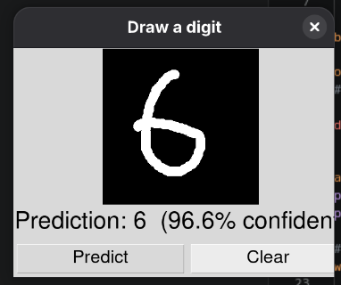
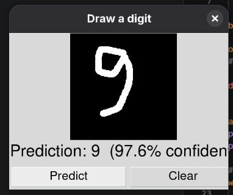

# Neural Net From Scratch

A two-layer neural network trained on MNIST, written with nothing but `numpy`.
No PyTorch, no TensorFlow, no autograd — every forward pass, every gradient,
every weight update is something I wrote and derived by hand. The point
wasn't to get the best possible accuracy, it was to actually understand what
`model.fit()` is hiding from you.

There's also a small `tkinter` app at the end where you can draw a digit with
your mouse and watch the network guess it.

**Live demo:** [santoshmuruggu.github.io/Nueral-Network-from-scratch-on-MNIST](https://santoshmuruggu.github.io/Nueral-Network-from-scratch-on-MNIST/)
— the same trained weights and the same preprocessing, ported to plain
JavaScript so it runs entirely in the browser (no server, no ML library).

## Why bother doing it by hand

It's easy to stack `Dense` layers in Keras and never think about what's
happening between them. I wanted to feel the mechanics: what a gradient
actually is, why `softmax` + cross-entropy has that suspiciously clean
derivative, why weight initialization scale matters, why a bug in your
backward pass silently trains a slightly-worse network instead of crashing.
`neural_network.py` is the scratchpad where I worked through the pieces one
at a time (a manual forward pass with `relu`, then `softmax`, then the
negative-log-likelihood loss) before putting it all together properly in
`mnist_nueral_network.py`.

## Architecture

Nothing fancy — a single hidden layer is enough to comfortably clear 97-98%
on MNIST, and it's small enough to keep the whole computation graph in your
head:

```
input (784) -> [W1, b1] -> ReLU -> hidden (128) -> [W2, b2] -> softmax -> output (10)
```

- **Weight init**: He initialization (`std = sqrt(2 / fan_in)`), since the
  hidden layer uses ReLU and plain small-random-noise init makes deep(ish)
  nets start too flat to learn quickly.
- **Loss**: cross-entropy on the softmax output, with the usual
  `-log(p + 1e-9)` epsilon so a confident-and-wrong prediction doesn't blow
  up to `-inf`.
- **Backprop**: the softmax+cross-entropy combo collapses to a beautifully
  simple gradient, `dL/dz = probs - y_onehot`, so I lean on that instead of
  differentiating softmax and cross-entropy separately — it's the same
  result, just without the extra Jacobian bookkeeping.
- **Optimizer**: plain mini-batch SGD. No momentum, no Adam — deliberately,
  so the loss curve reflects the raw gradient signal and not an optimizer
  smoothing over my mistakes.

## Training

```
python3 mnist_nueral_network.py
```

Loads `mnist.pkl.gz` (the classic 50k/10k/10k train/val/test split), one-hot
encodes the labels, and trains for 10 epochs with batch size 64 and a
learning rate of 0.5. Prints loss and validation accuracy per epoch, then a
final test accuracy, then pickles the weights to `model.pkl`:

```
epoch 1/10   loss: 0.2667   val_acc: 0.9532
...
epoch 10/10  loss: 0.0134   val_acc: 0.9761
test accuracy: 0.9787
```

~98% on held-out test data from a from-scratch, single-hidden-layer,
plain-SGD network. Good enough that the interesting failures left are the
genuinely ambiguous digits (5 that looks like a 6, that kind of thing) —
which felt like the right place to stop tuning and go build something with
it.

## Drawing app

```
python3 draw_predict.py
```

A `tkinter` canvas where you draw a digit with the mouse; hit **Predict** and
it runs the drawing through the saved model.

<p align="center">
  
  
</p>

The first version of this just shrank the raw 280x280 canvas down to 28x28
and fed it straight to the network — and it was bad. An `8` would come back
as a `3`. Not a model problem: MNIST digits aren't just downsampled scans,
they're bounding-box-cropped, scaled so the longer side fills ~20 of the 28
pixels, and centered. A network trained exclusively on that convention has
zero translation or scale invariance baked in — it has never seen a digit
drawn small in the corner of the frame, so it has no reason to handle one
well. Once I replicated that preprocessing (crop to the ink, aspect-preserving
resize to a 20px box, center in the 28x28 frame) the accuracy problem more or
less disappeared. It was a good reminder that "the model is wrong" is usually
"the input doesn't look like what the model was trained on."

## Files

| file | what it does |
|---|---|
| `neural_network.py` | scratch work — manual forward pass, relu, softmax, loss, one array at a time |
| `mnist_nueral_network.py` | the real thing: full train/val/test pipeline, backprop, mini-batch SGD, saves `model.pkl` |
| `draw_predict.py` | tkinter drawing canvas + MNIST-style preprocessing + inference on the saved model |
| `model.pkl` | trained weights (`W1`, `b1`, `W2`, `b2`) |
| `docs/` | the browser version (GitHub Pages): `nn.js` is a line-for-line port of the preprocessing and forward pass, `weights.bin` is `model.pkl` as float32 |
| `mnist.pkl.gz` | the dataset (not committed — see `.gitignore`) |
| `test1.png`, `test2.png` | screenshots of the drawing app calling a 6 and a 9 correctly |

## What's next

- A second hidden layer, mostly to see how much it actually buys over the
  single-layer baseline.
- Swap plain SGD for momentum or Adam and compare convergence speed on the
  same architecture.
- Center the drawn digit by center-of-mass instead of bounding-box center —
  closer to the real MNIST preprocessing and should help the borderline
  cases.
- Eventually: a convolutional layer, written by hand too, once the
  fully-connected version stops being interesting.
